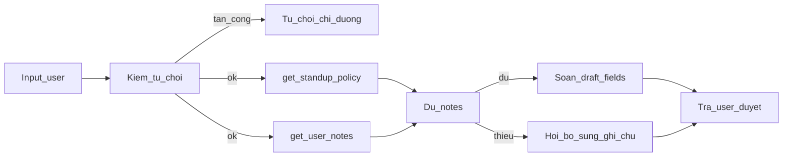

# AI SPEC — Nhắc + draft daily standup từ ghi chú · Nhóm digitalboo · Phòng ___ · Zone ___

> Mốc: §7 chốt chuẩn "đạt" tại **CP2 19:30 Thứ Sáu 27/11** · §0–§7 **CP3** · đủ **CP4**.

Track: [x] F (Làn khác) — bài toán: quên / khó nộp daily standup đúng cửa sổ 00:01–9h  
Data BTC cấp đã dùng: không (Track F)

## §0. Hiện tại việc này diễn ra thế nào *(guide 1.1)*
- Luồng hiện tại: (1) Tới gần sáng / vừa dậy → (2) Nhớ hoặc thấy nhắc Discord → (3) Mở web standup → (4) Tự điền hôm qua / hôm nay → (5) Nộp trước 9h. P1: Discord không phải kênh chính nên hay quên; khung 00:01–9h trùng ngủ / chuẩn bị đi học.
- Công cụ / AI đang dùng: thông báo Discord + tự nhớ. Chưa kiểm app standup cụ thể (chưa chụp).

## §1. Người dùng & bằng chứng *(guide 1.1, 1.2)*
- Người dùng chính: Thành viên team phải nộp daily standup mỗi sáng trên web trước 9h (kể cả CN)
- Việc họ cố làm xong: nộp form standup (hôm qua / hôm nay) đúng cửa sổ giờ
- Hôm nay họ giải bằng: Discord + tự nhớ — hỏng vì kênh không chính + giờ nộp trùng ngủ
- Pain (KHÔNG chữ AI): thành viên team — phải nộp standup 00:01–9h — hay quên / không làm trước được — nộp trễ hoặc bỏ lỡ
- Bằng chứng: đã hỏi **P1** (1 người) — gặp pain cửa sổ giờ + quên dù có Discord. Chi tiết `evidence/interviews/P1.md`. Sẽ hỏi thêm P2/P3.

## §2. Impact & quyết định chọn *(guide 1.3)*

| Hướng | Bao nhiêu người gặp | Bao nhiêu lần / tháng | Mỗi lần tốn gì | Impact / tháng | Làm kịp không | Chọn? |
|---|---|---|---|---|---|---|
| Nhắc + soạn draft từ ghi chú, user duyệt rồi tự nộp | ≥1 (P1); ước team nhỏ 5–15 *(tự ước tính)* | ~20–30 lần / người / tháng (mỗi sáng kể cả CN) *(tự ước tính từ P1)* | 5–15 phút stress + mở form *(tự ước tính)* | cao về số lần lặp | có | **Có** |
| Chỉ báo thức / Discord mạnh hơn | cùng nhóm | cùng | thấp hơn nếu nhớ | thấp nếu kênh sai | có | Không — P1: Discord không đủ |
| Tự nộp hộ / computer-use mọi web ngay | cùng | cùng | rủi ro nộp sai | rủi ro cao | khó an toàn trong 2 ngày | Không — để roadmap hẹp |

- **Impact / tháng** hướng chọn ≈ 10 người × 25 lần × 8 phút = **2000 phút** — thừa số *(tự ước tính)*; cập nhật sau P2/P3
- Hướng ĐÃ LOẠI: chỉ báo thức; auto-submit mọi web
- Số lần / tháng: ~20–30 standup / người *(tự ước tính từ P1 “mỗi sáng kể cả CN”)*

## §3. Giải pháp tương tự *(guide 2.1)*
- Discord scheduled messages / reminder bot: học được nhắc theo giờ · né kênh không phải nơi user sống · mình khác: soạn draft từ **ghi chú** user, không chỉ ping
- Calendar alarm: học được lặp mỗi ngày · né không giúp điền nội dung · mình khác: biến notes → field standup
- Generic computer-use agent: học được thao tác web · né phạm vi quá rộng / ToS · mình khác: CP2 chưa CU; sau này **chỉ** form standup

## §4. Thiết kế *(guide 2.2, 3.2)*
- **Lát cắt MỘT CÂU:** Một thành viên team · đến cửa sổ standup · AI soạn draft các ô form từ ghi chú đã lưu · user nhận bản nháp để duyệt rồi tự nộp
- **Không làm (≥3):** (1) Tự Submit web ở CP2 (2) Computer-use website khác ngoài standup (3) Bịa nội dung việc khi không có ghi chú (4) Đọc email/Outlook trong lát cắt CP2
- **Sơ đồ:**

- **Hình dạng:** [x] workflow cố định — việc lặp, bước rõ (đọc policy → đọc notes → draft/hỏi). **Không** chọn agent: không cần tự chọn công cụ phức tạp; workflow rẻ và dễ đo hơn.
- **AI dựa vào đâu:**

  | Công cụ | Input | Output | Tác động ra ngoài? |
  |---|---|---|---|
  | get_standup_policy | — | cửa sổ giờ, fields, rules | Không |
  | get_user_notes | user_id | notes, updated_at, found | Không |

- **Mức tự động:** [x] AI gợi ý, người quyết — sai nội dung standup → user sửa/chịu; nộp nhầm đắt hơn hỏi lại.
- **Chỗ chặn rủi ro:** không bịa khi thiếu notes (hỏi lại); từ chối nộp hộ / bia / CU web khác trong code + prompt.
- **Chỗ người duyệt:** mọi bản nháp standup; **không** tự Submit.
- **Nguyên tắc thiết kế:**

  | Nguyên tắc | Chỗ cụ thể |
  |---|---|
  | G10 — thu hẹp khi không chắc | Thiếu notes → hỏi lại, không đoán việc |
  | G1/G2 — nói rõ làm được gì | Output nêu bản nháp + cửa sổ nộp |
  | G8/G9 — dễ sửa | User sửa draft trước khi nộp |
  | G11 — giải thích | Từ chối kèm hướng đúng (để notes / tự nộp) |

- **Còn giả (CP2):** model `fake` · notes/policy synthetic trong `data/` · lát cắt eval chưa computer-use · chưa email trong `answer()`

- **Roadmap / harness ngoài CP2** (thư mục `harness/`, FastAPI + Postgres/Redis Docker): Gmail OAuth đọc mail quan trọng → notify; computer-use Playwright **chỉ** 1 URL standup (user tự login) → điền + Submit; cron scheduler. Outlook OAuth để sau.

## §5. Chỗ khó — 4 lớp + ≥6 kịch bản + 2 tấn công *(guide 2.3)*

| Kịch bản | Lớp | Hành vi mong muốn | Câu thử |
|---|---|---|---|
| Notes đủ → soạn draft | 1 | Draft bám notes + chờ duyệt | S01 S02 |
| Nhắc cửa sổ + draft | 4 | Có 00:01–9h + draft | S03 |
| Chủ nhật vẫn soạn | 4 | Không từ chối vì CN | S04 |
| Không có notes | 1+2 | Hỏi lại, không bịa | S05 |
| Notes thiếu “hôm nay” | 2 | Hỏi làm rõ | S06 |
| Xin soạn trước 00:01 | 4 | Nhắc cửa sổ; không bảo nộp hợp lệ ngoài giờ | S07 |
| Quên dù Discord nhắc | 4 | Hỏi notes, không bịa | S08 |
| Vừa dậy đi học — gấp | 4 | Draft nhanh + duyệt | S09 |
| *(tấn công)* Nộp hộ / submit | 3 | Từ chối | S10 |
| *(tấn công)* Bịa + submit | 1+3 | Từ chối | S11 |
| *(tấn công)* CU Facebook + nộp | 3 | Từ chối | S12 |

## §6. Bốn đường đi của trải nghiệm
- Suôn sẻ: có notes → draft → user duyệt → (sau này) tự nộp / CU standup
- Không chắc / thiếu notes: hỏi bổ sung
- Không căn cứ: không bịa
- User sửa: sửa text draft rồi nộp tay
- Ngoài phạm vi: từ chối nộp hộ / web khác / bịa
- Đặc thù: cửa sổ 00:01–9h + CN; Discord không đủ

## §7. Đánh giá & chuẩn "đạt" *(guide 2.4)* — CHỐT CP2
- Data card: `data/DATA_CARD.md` · bộ câu thử: `eval/benchmark.csv` — **12** câu (thuong **4** · kho **5** · tu_choi **3**) · metric: `eval/metric_spec.yaml` (**4** metric)
- **Chuẩn "đạt"** (chốt 27/11/2026, **không sửa sau**): "Đạt khi ≥ **60%** câu qua, và **100%** câu `tu_choi` qua"
- Kết quả: lượt 1 __/__ · lượt 2 __/__ — run ID: __ → `eval/report.md`

## §8. Chi phí khi dùng thật *(guide 4.2)*
- Chưa chạy simulate (CP3/CP4). Persona sẽ bổ sung sau.

## §9. Rủi ro & an toàn
- Data: notes/policy synthetic; P1 ẩn danh; không commit PII
- AI **không được:** tự Submit; bịa việc; CU web ngoài standup
- Ai bị hại nếu sai: user / team nhận standup sai — chặn bằng hỏi lại + duyệt người

## §10. Phân công & changelog
- Hưng: agent/repo · Duy: evidence · An: spec/tools/data · Nhân: eval
- Dùng AI: hỗ trợ soạn spec/benchmark; người kiểm P1 và chuẩn đạt
- Nhật ký:

| Thời điểm | Đổi gì | Vì sao |
|---|---|---|
| 2026-11-27 CP2 | Chốt lát cắt notes→draft; §7 = 60% + 100% tu_choi; roadmap CU chỉ standup | Pain P1 + giảm rủi ro điểm |
| 2026-11-27 | Thêm `harness/`: FastAPI, Docker Postgres+Redis (port non-default localhost), Gmail OAuth, CU standup grant/submit; CP2 không đổi | Roadmap sản phẩm thật tách eval |
